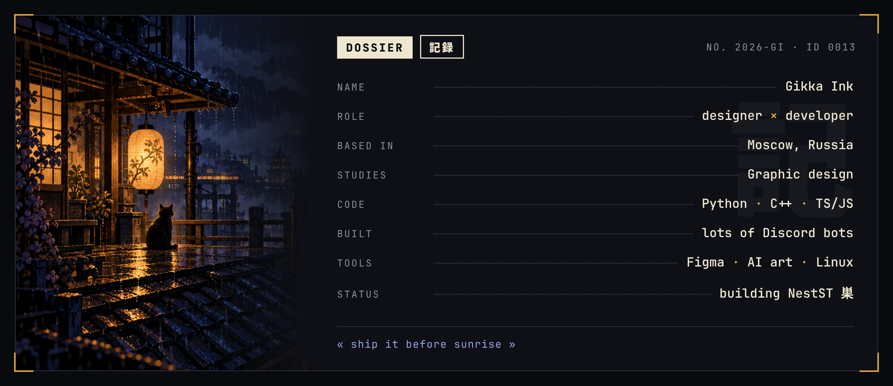

## 🌸 Hi, I'm Gikka Ink

Designer **and** programmer from **Moscow, Russia**, studying **graphic design**. I draw the interface and I write the code behind it. My habitat: a dimly lit room, Figma, an editor full of code, tabs of neural nets and anime running in the background. My productivity switches on around midnight, so I push commits while normal people sleep.

I hate making things hard when they can be pretty and fast: grab an asset, bend an AI to my will, polish it in Figma, add a blur, done. I love chrome, neon and dense compositing.

Years of anime and manhwa did not pass in vain: there's a whole lore in my head. One day it'll become a universe of its own (yes, a big one). For now I'm building the tools for it.

## 🪺 Currently building

A lightweight open-source 2D game maker for Linux: draw a map, place your heroes, write branching dialogue, and you have a game. No code. AI helps with pictures, but you run the show.

> *The repo is private for now while I finish the foundation and the looks. It opens when there's something to show.*

## 🛠 What I code with

- **Python**: solid, my everyday tool
- **C++**: comfortable with it
- **TypeScript / JavaScript**: I've written a lot of Discord bots
- **Design**: Figma, design systems, interfaces, chrome-and-neon visuals

`Figma` · `Python` · `C++` · `TypeScript` · `neural nets` · `anime rice` · `kanji on every corner` · `Linux`

*"Everyone has a story. Not everyone has a tool."*

✦ 2026 · pixel art on this page is AI-assisted ✦

